# fictional-bassoon

Relay is a full-stack AI chat application with streamed answers, visible web-search activity, persistent conversations, and local tracing dashboards.

## Overview

This project is a showcase of distributed systems engineering applied to AI agents. It streams real-time agent reasoning, tool calls, tool results, and final answers to the browser via **Server-Sent Events (SSE)**, speaking the **[AG-UI protocol](https://docs.ag-ui.com/)** event vocabulary end-to-end. The architecture offloads heavy "Deep Agent" workloads to asynchronous workers, persists conversation state in a PostgreSQL/Citus cluster, and integrates infrastructure metrics and LLM tracing. The verified local run below records what works and what remains incomplete.

## Capabilities

| Capability | What you can do | Current scope |
|---|---|---|
| Authenticated conversations | Sign up, log in, create chats, and revisit saved answers | Owner-scoped thread APIs and persisted checkpoint history |
| Streaming answers | Watch answers arrive while the worker runs | AG-UI output events over SSE; custom chat request shape |
| Web search | Ask for current information and inspect search activity | Tavily tool; requires configured provider credentials |
| Interactive generated UI | Ask for a comparison, get model-authored cards and a choice list, and send your pick back for a tailored follow-up | Restricted A2UI v1.0 profile: `createSurface` with six standard components and one `select_option` action |
| Declarative chat UI | See tool cards and formatted answers assembled from streamed component trees | Four-component custom tree, separate from the interactive surfaces |
| Agent-to-agent access | Let another agent discover and invoke this backend | A2A server with JWT authentication; no outbound A2A client |
| LLM tracing | Inspect prompts, outputs, model generations, token usage, and cost | Langfuse; verified with a real chat |
| Infrastructure visibility | Inspect queues, cache, object storage, database traces, and metrics | Dashboard screenshots below; Grafana log ingestion remains unverified |
| Distributed execution and storage | Run agent work through Celery/RabbitMQ and persist API data in Citus | Checkpoint tables currently use the coordinator-local fallback |

Start with the [interactive A2UI demo](#a2ui-demo-interactive-comparison-and-selection), [local screenshots](#verified-local-run--1-november-2026), or [setup instructions](#quick-start-unified-stack). See [release notes](release.md) for the change history and limitations.

### Protocol roles

The app is built on three open agent protocols (all version-pinned — see `.codex/rules/protocol-version-pinning.md`):

| Protocol | Role here | Where |
|---|---|---|
| **AG-UI** (`ag-ui-protocol==0.1.21`) | Agent → frontend event stream over SSE: `RUN_*`, `STEP_*`, `TEXT_MESSAGE_*`, `REASONING_MESSAGE_*`, `TOOL_CALL_*` | `backend/utils/streaming.py` → `frontend/src/hooks/useSSEStream.ts` |
| **A2UI** (spec v1.0 candidate, restricted profile) | Model-authored interactive surfaces: standard `createSurface` envelopes (`Text`, `Column`, `Row`, `Card`, `ChoicePicker`, `Button`) validated against the vendored `@a2ui/web_core@0.10.6` schemas, with one `select_option` action routed back to the agent. Chat blocks still use a separate four-type tree (`column` / `reasoning` / `tool_call` / `markdown`). No executable UI | `backend/src/interactive_ui.py`, `frontend/src/lib/a2ui/` |
| **A2A** (`a2a-sdk[fastapi]==1.1.2`) | Exposes the backend as a callable service for other agents: Agent Card + JSON-RPC, with `taskId` == `job_id` and `contextId` == `thread_id` (one ID system, not three) | `backend/src/protocol/` — `GET /.well-known/agent-card.json`, `POST /a2a` |

## A2UI demo: interactive comparison and selection

Try this prompt in a new chat with an OpenAI key configured:

> Compare FastAPI, Flask, and Django for a small API project, and let me select one for a follow-up recommendation.

The agent calls the `render_interactive_ui` tool with a component list it writes itself. The server validates that list against the vendored A2UI v1.0 schemas and a narrower safety profile, then streams it as an AG-UI `CUSTOM` event named `a2ui.surface` whose value is a standard `createSurface` envelope. The browser validates it again before rendering it with native, accessible controls.

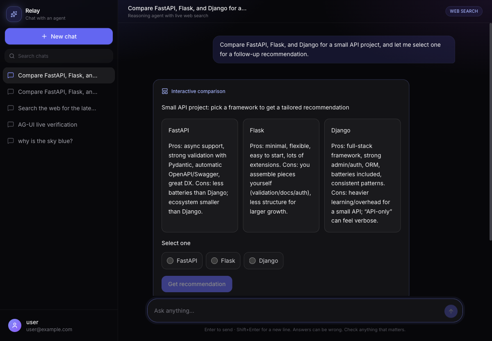

The model chose this layout (an intro line, a `Row` of three `Card`s, a `ChoicePicker` and a primary `Button`); the server did not fill in a template. Selecting **Django** and pressing **Get recommendation** sent one `/chat` request carrying a standard `select_option` action. The server confirmed the user owns the thread, matched the action to a surface it had issued in that thread's checkpoint, and replaced the browser's message with canonical text built from the chosen option. The agent then replied with a Django-specific recommendation.

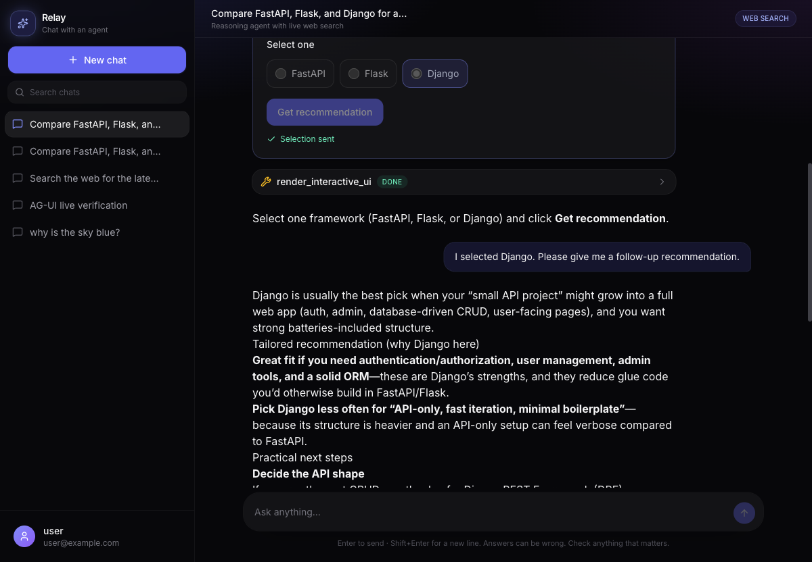

Verified live on 1 November 2026 against the local stack (`openai:gpt-5.4-nano`):

- In a fresh API run and a fresh browser run, the model's **first** `render_interactive_ui` call produced a valid surface. The earlier failure (three rejected calls using `type` instead of `component`) was fixed by giving the model an explicit per-component input schema and actionable validation errors.
- Submitting a selection sent exactly one `/chat` request; the run ended with `RUN_FINISHED`, no `RUN_ERROR`, and no browser console errors or warnings.
- Switching to another thread and back, and a full page reload, both restored the cards with the selected option and *Selection sent* state.
- Over the API, an option that was never offered and a surface ID that was never issued were each rejected with HTTP 422 before anything was queued.

**Limitations.** This is a restricted A2UI v1.0 *candidate* profile, not full conformance. Only `createSurface` is emitted; there is no `updateComponents`, `updateDataModel`, or `deleteSurface`. Six components are supported, with exactly one single-choice picker bound to `/selection` and one button whose only action is `select_option`. There are no function calls, other data bindings, remote content, or HTML, and the selection never triggers an external operation. The `@a2ui/react` renderer is not used. Retrying after a failed submission is covered by unit tests but was not forced in a live run. A model may still produce an invalid tree; the tool then returns an error naming the bad component and field so the model can correct itself, and invalid trees are never rendered.

## A2UI demo: web search and rendered answer (chat blocks)

Try this prompt in a new chat with OpenAI and Tavily credentials configured:

> Search the web for the latest FastAPI release. Show the version, summarize three changes in bullet points, and link to the official release notes.

The live browser run on 1 November 2026 displayed **three completed Tavily search cards** followed by a formatted answer with a release-notes link. The captured HTTP 200 stream contained **608 events**, including **301 `CUSTOM` events named `a2ui`** with `column`, `tool_call`, and `markdown` components. Tool start, arguments, completion, and result events were observed; the run ended with `RUN_FINISHED` and no `RUN_ERROR`.

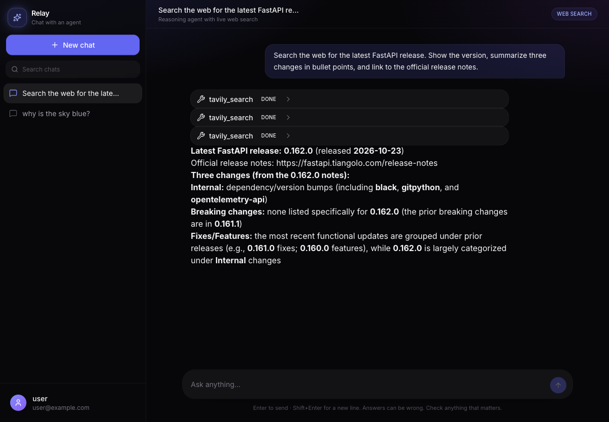

This demonstrates the separate **four-component chat-block tree**: the backend constructs a validated tree from agent output, and the frontend renders it. The fourth supported component, `reasoning`, was not observed in this run. In this path the model does not design layouts; model-authored interactive surfaces are covered by the [interactive demo](#a2ui-demo-interactive-comparison-and-selection) above. The screenshot records the model's answer, not an independent verification of its release claims.

## Architecture

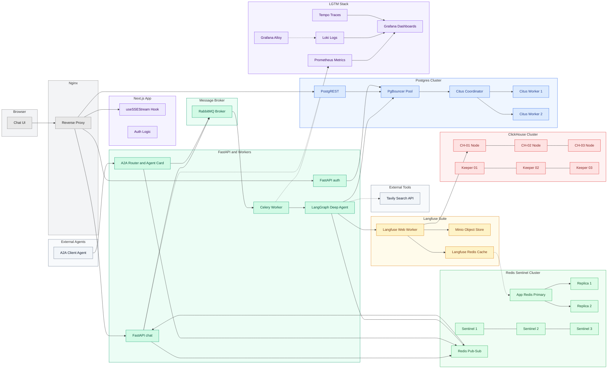

## How a chat message streams

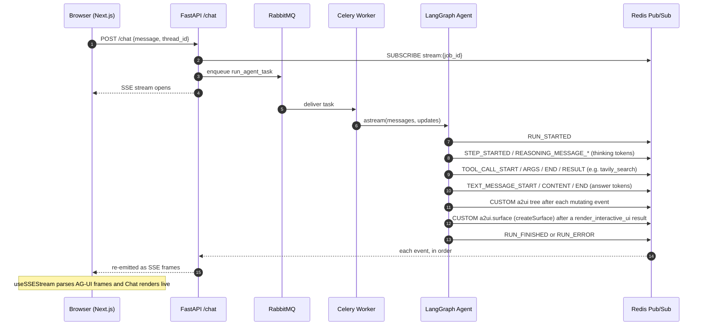

The same pipeline is reachable by other agents over **A2A**: a JSON-RPC `SendMessage` to `POST /a2a` enqueues the identical Celery task and maps the AG-UI terminal events onto A2A task states (`submitted → working → completed/failed`), with a 120s idle timeout guarding against dead workers.

## Key Design Decisions

- **Protocol-driven surfaces (AG-UI · A2UI · A2A)**
  The agent↔frontend stream, the rendering contract, and the service-to-service interface each follow an open protocol instead of a hand-rolled vocabulary. Versions are pinned and verified against the installed packages (`.codex/rules/protocol-version-pinning.md`); the A2UI implementation is deliberately scoped and non-executable: model-authored `createSurface` envelopes in a six-component profile with a single server-verified `select_option` action, alongside the four-type chat-block tree.

- **SSE over WebSockets**
  Simpler, more reliable streaming model for server → client updates. Leverages standard HTTP and provides automatic keep-alive support via FastAPI's `EventSourceResponse`.

- **Celery + RabbitMQ for Orchestration**
  Decouples the long-running agent reasoning process from the HTTP request lifecycle, ensuring the API remains responsive.

- **Authenticated thread APIs**
  FastAPI enforces ownership for thread management, chat, and history. Direct PostgREST access to thread/message tables is revoked; history comes from the LangGraph checkpointer.

- **Redis Sentinel for High Availability**
  Ensures resilient pub/sub event streaming and caching for distributed components.

- **Dual PgBouncer Pools (Transaction + Session)**
  Optimizes database connectivity by separating short-lived API queries from long-lived agent state connections.

- **Citus sharded by `thread_id`**
  Coordinator + 2 workers. FastAPI startup registers the workers (`citus_add_node`) and distributes `api.threads` by `id`, `api.messages` by `thread_id` (colocated), and `api.users` as a reference table. LangGraph checkpoint tables are distributed by `thread_id` too; if Citus still rejects LangGraph's `jsonb_each_text` subquery they stay local on the coordinator (see `.claude/rules/citus-thread-id-integrity.md`).

- **Langfuse Observability & Clickhouse**
  Provides deep tracing of agent trajectories, token usage analysis, and detailed execution logs for production debugging. Langfuse utilizes Redis/Valkey for asynchronous event queuing (via BullMQ), API key validation, and prompt caching.

- **LGTM Stack for Infrastructure Monitoring**
  Full integration of Loki (logs), Grafana (dashboards), Tempo (tracing), and Prometheus (metrics) across all distributed boundaries.

## Project Structure

```
fictional-bassoon/
├── docker/                     # Master Orchestration
│   ├── docker-compose.yml      # Unified Stack Config
│   └── nginx/                  # Reverse Proxy Config
├── backend/                    # FastAPI Backend
│   ├── main.py                 # API Entry Point (/chat, /auth)
│   ├── src/                    # Logic, Models, & Auth
│   ├── docker/                 # Monitoring, Citus & Redis config
│   └── docker-compose.yaml     # Backend-specific Stack
└── frontend/                   # Next.js Frontend
    ├── src/                    # UI Components & Context
    └── docker-compose.yaml     # Frontend-specific Stack
```

## Quick Start (Unified Stack)

The easiest way to run the entire application is through the Makefile (which drives the master Docker Compose in `docker/`):

```bash
make up          # start all services (detached)
make up-build    # rebuild images, then start
make logs        # follow logs
make down        # stop and remove containers
make clean       # remove volumes and images too
```

You'll need `backend/.env` populated first (see the table in `backend/README.md` — at minimum `OPENAI_API_KEY` and `TAVILY_API_KEY`). Once up:

- Chat UI: [http://localhost:3000](http://localhost:3000) (or via nginx at [http://localhost](http://localhost))
- A2A Agent Card: [http://localhost:8000/.well-known/agent-card.json](http://localhost:8000/.well-known/agent-card.json)

## Local Development

### 0. Pre-commit Hooks Setup (First Time Only)

This project uses [pre-commit](https://pre-commit.com/) to automatically run linters, formatters, and type checkers before commits.

```bash
# Install pre-commit framework
uv pip install pre-commit

# Install git hooks into your repository
pre-commit install

# Install frontend dependencies
cd frontend && npm install && cd ..
```

After setup, hooks will run automatically on every `git commit`. To manually test:
```bash
pre-commit run --all-files
```

**Hooks configured:**
- **Backend:** Ruff (linting), Mypy (type checking)
- **Frontend:** ESLint, Prettier, TypeScript type checking, Vitest tests
- **General:** YAML validation, file formatting checks

### 1. Start Infrastructure
```bash
cd backend
docker compose up -d
```

### 2. Backend Setup
```bash
cd backend
uv sync
source .venv/bin/activate
celery -A src.celery_app worker --loglevel=info &
uvicorn main:app --reload
```

### 3. Frontend Setup
```bash
cd frontend
npm install
npm run dev
```

## Testing

Both stacks hold a ≥90% coverage gate (statements/lines):

```bash
# Backend — 95% coverage
cd backend && uv run pytest -q --cov=.

# Frontend — 93.97% statements / 95.35% lines
cd frontend && npm run test:coverage
```

## Monitoring & Observability

Consolidated access through Nginx and direct ports:

| Service | Proxy URL | Direct URL | Purpose |
|---|---|---|---|
| **Chat UI** | [http://localhost](http://localhost) | [http://localhost:3000](http://localhost:3000) | Main Application |
| **API Docs** | [http://localhost/api/docs](http://localhost/api/docs) | [http://localhost:8000/docs](http://localhost:8000/docs) | API Reference |
| **Langfuse** | - | [http://localhost:4000](http://localhost:4000) | LLM Tracing & Observability (3030 is the worker, not the UI) |
| **PostgREST** | [http://localhost/api/db](http://localhost/api/db) | [http://localhost:3002](http://localhost:3002) | REST API; no standalone browser UI |
| **Grafana** | - | [http://localhost:3001](http://localhost:3001) | Dashboards & Logs |
| **Prometheus** | - | [http://localhost:9090](http://localhost:9090) | Metrics |
| **Redis Insight** | - | [http://localhost:5540](http://localhost:5540) | Redis GUI |


## Verified local run — 1 November 2026

These screenshots are from the running `bassoon-local` stack, using persisted local test data and a real OpenAI reply. They demonstrate the listed checks, not production readiness or complete failover testing. Its loopback-only ports differ from the standard Compose ports above. Credentials are deliberately excluded from this README; local test login details are in the ignored `handoffs/local-stack/user-accounts.md` file.

| Interface | Running local URL | Result |
|---|---|---|
| Relay app | http://localhost:8080 | `user` asked “why is the sky blue?” and received a real reply |
| Langfuse | http://localhost:3001 | Matching input, output, model generation, tokens and cost visible to `user` |
| Grafana | http://localhost:3002 | Request-rate and duration charts populated; log panel currently has no data |
| RabbitMQ Management | http://localhost:15672 | Authenticated overview shows connections, consumers and message activity |
| Redis Insight | http://localhost:5540 | Connected to app-redis-primary:6379; connection test passed and key browser populated |
| Prometheus | http://localhost:9090/targets | All 26 scrape targets up |
| MinIO Console | http://localhost:9001 | Private Langfuse bucket and event folders visible; 12 stored objects |
| ClickHouse Query | http://localhost:18123/play | Read-only query returns persisted trace/observation tables |
| Grafana Alloy | http://localhost:12345 | All four configured components report healthy; this alone does not prove logs reach Grafana |
| FastAPI Swagger UI | http://localhost:18000/docs | Schema and endpoints render on the direct backend route |

The app-prefixed `/api/docs` page currently fails to fetch `/openapi.json`; use the direct documentation URL above. Loki and Tempo are accessed through Grafana, not standalone application frontends. PostgreSQL/Citus, PgBouncer, Redis servers/Sentinels, ClickHouse Keeper, Celery, and exporters do not provide comparable application dashboards. Replica instances share the same service interface and are not duplicated in the gallery.

### Chat and trace evidence

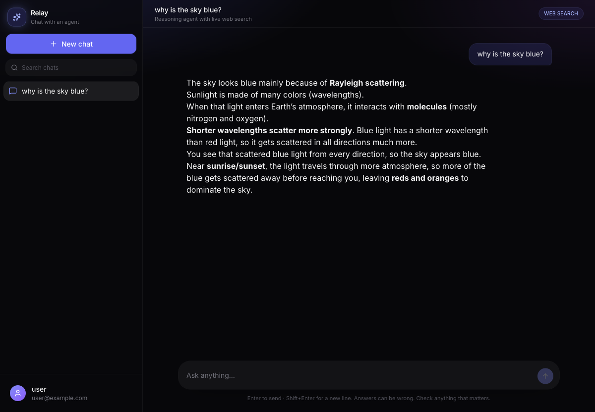

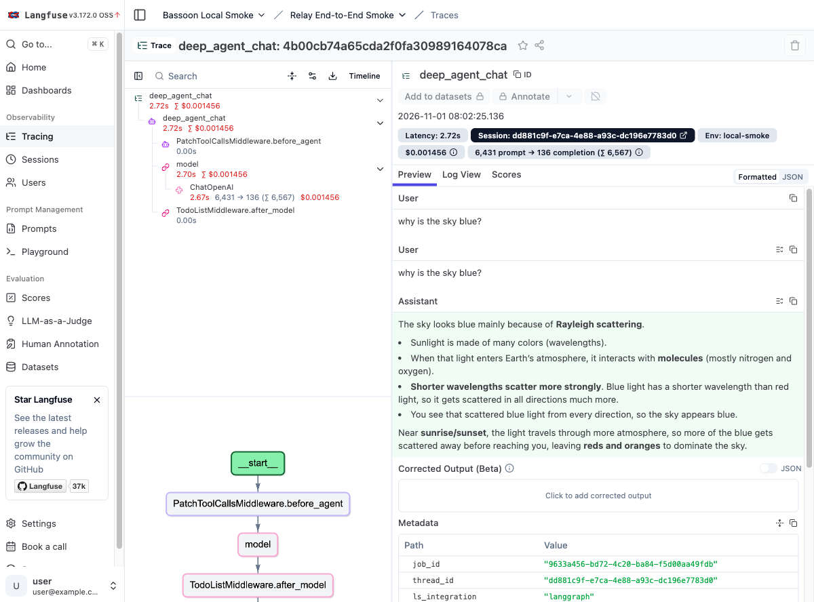

### Monitoring and infrastructure evidence

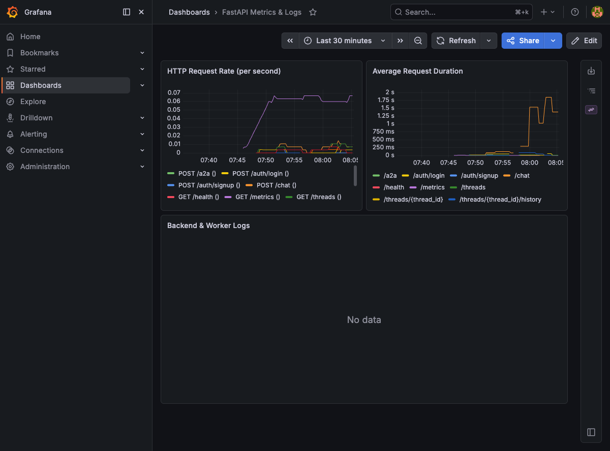

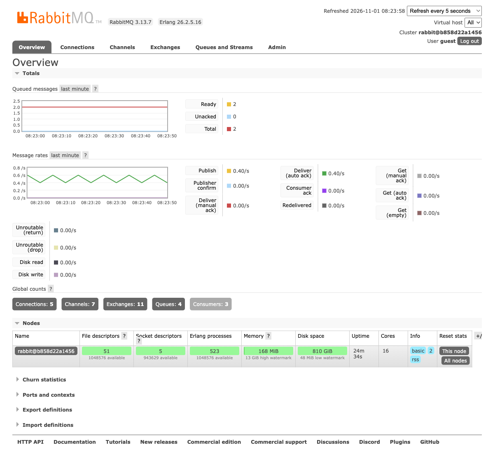

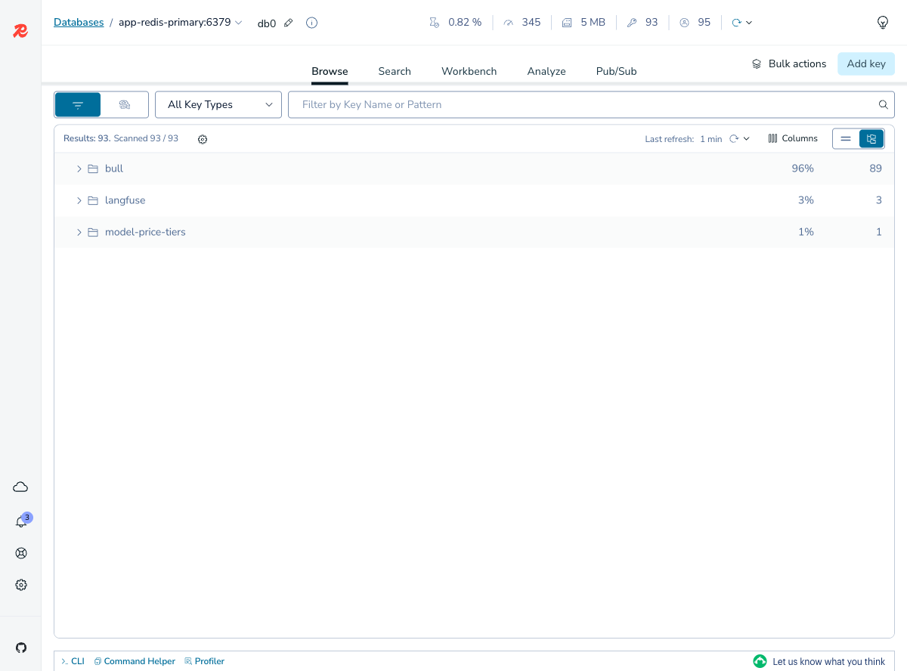

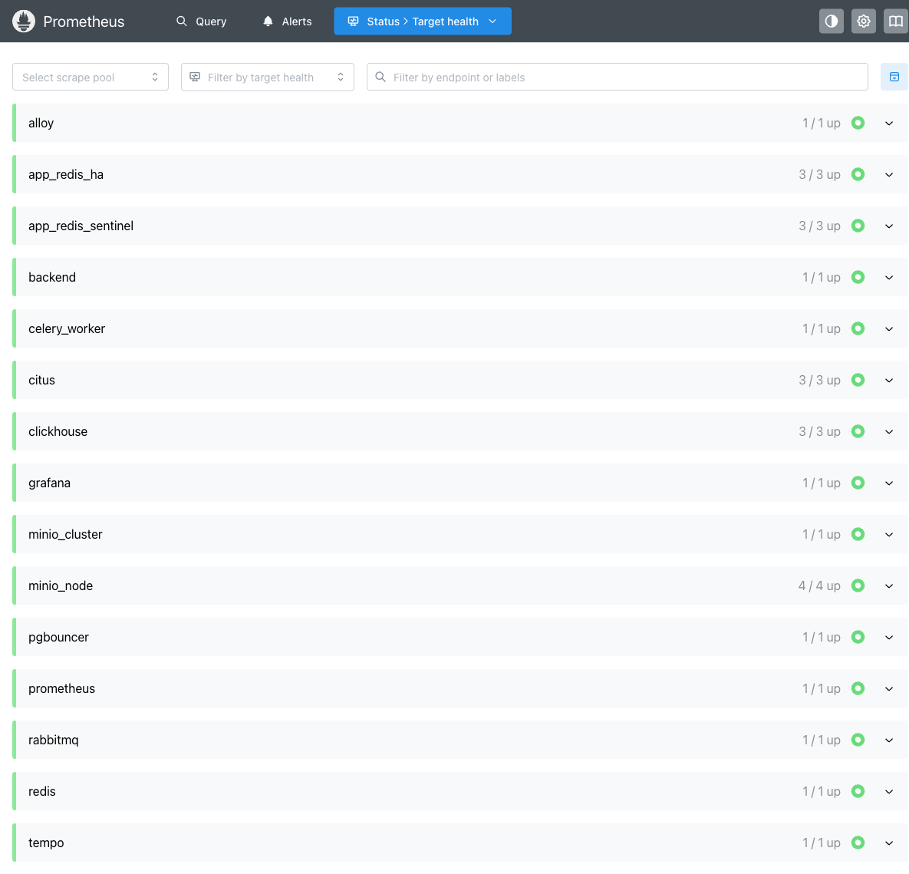

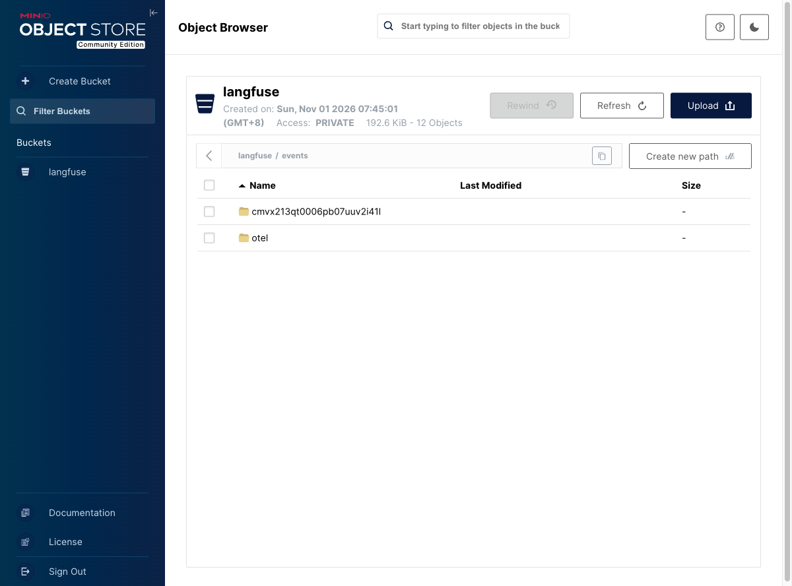

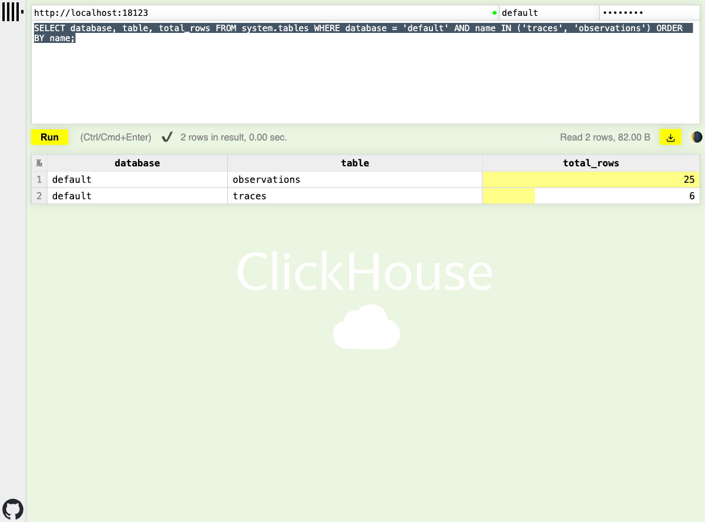

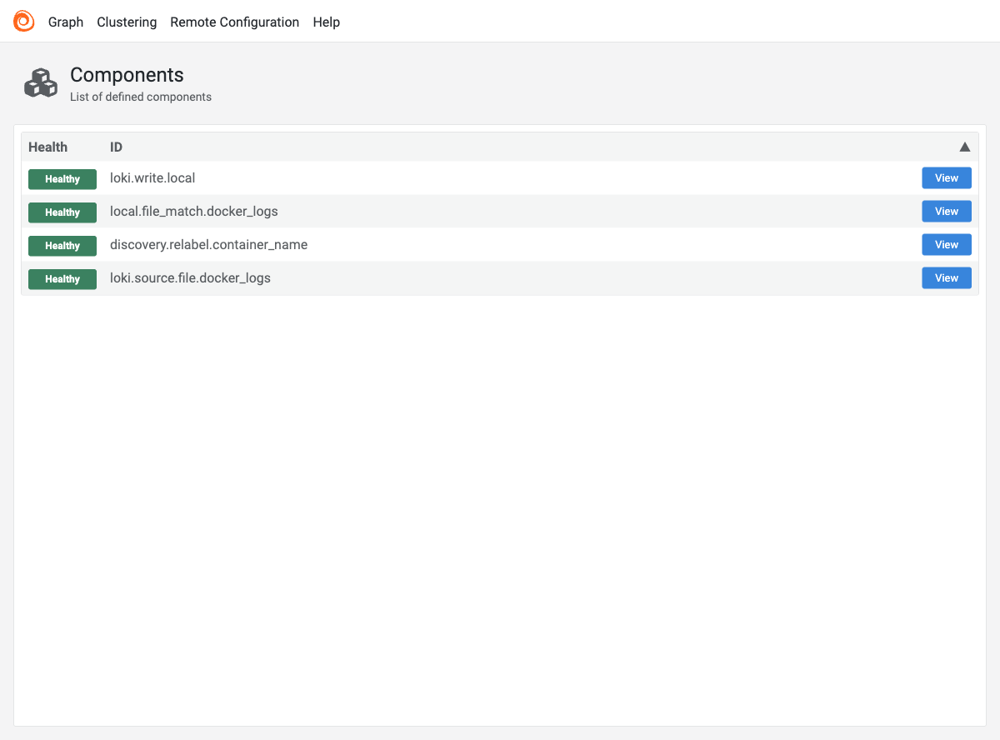

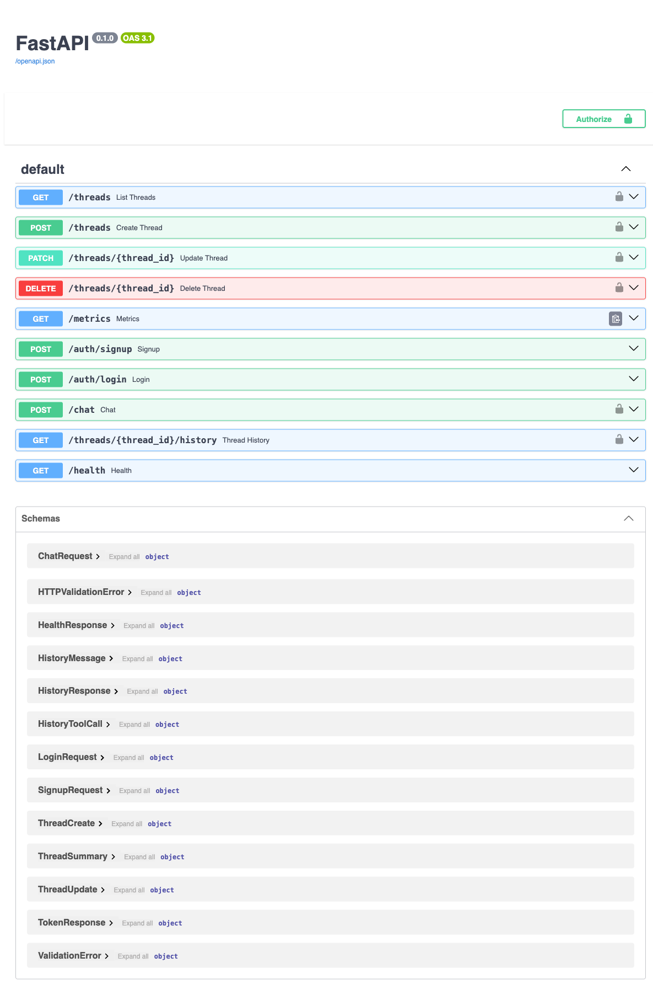

### A2A Agent Card

This app acts as an **A2A server**: external agents call it. Calling other A2A agents would require a separate client integration.

The running backend exposes an [Agent Card](http://localhost:18000/.well-known/agent-card.json) advertising A2A 1.0, streaming, chat, web search, and JWT authentication. Other agents can invoke this app through `http://localhost:8080/api/a2a`; this does not mean the app calls other agents through A2A.

Discovery returned HTTP 200, and an unauthenticated A2A request returned HTTP 401. This check did not send a fresh authenticated A2A chat. Task status is process-local and does not survive backend restarts or span replicas.

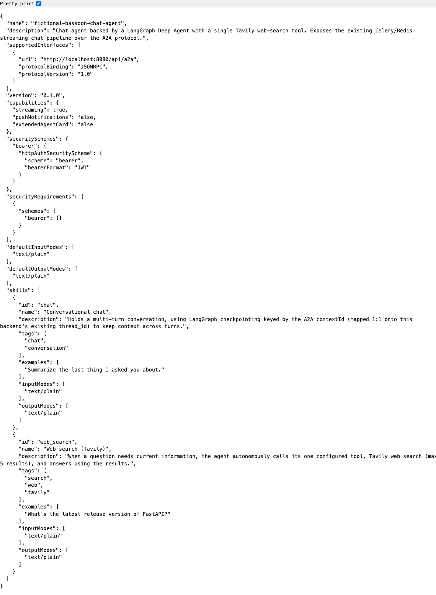

### AG-UI over SSE: verified

A live authenticated `POST /api/chat` returned `Content-Type: text/event-stream; charset=utf-8`. All **55 received events** validated against the installed **`ag-ui-protocol==0.1.21`** `Event` schema. SSE `event:` names matched each JSON payload's `type`.

Observed event types: `RUN_STARTED`, `TEXT_MESSAGE_START`, `TEXT_MESSAGE_CONTENT`, `CUSTOM` (A2UI), `TEXT_MESSAGE_END`, and `RUN_FINISHED`. The thread/run IDs matched at both ends, no `RUN_ERROR` occurred, and both conversation messages were read back from checkpoint history.

This verifies AG-UI output events over SSE. The HTTP request still uses the application's `{message, thread_id}` shape, not the full standard `RunAgentInput` contract. Tool-call and reasoning event paths were not exercised by this simple sky question. The separate A2UI web-search demo above subsequently exercised live tool-call events; reasoning events remain unverified in a live run. Do not interpret this as verification of every AG-UI capability or plug-and-play compatibility with every AG-UI client.

### Citus: working fallback, not a complete upstream fix

Citus **13.0-1** has an active coordinator and **two active workers**. `api.threads` and `api.messages` are hash-distributed and colocated; `api.users` is a reference table.

The current startup still logs `invalid attnum 6 for relation "jsonb_each_text"` when probing distributed LangGraph checkpoints. Bootstrap then undistributes `checkpoints`, `checkpoint_blobs`, and `checkpoint_writes`; all three are currently **local to the coordinator**. Chat and checkpoint history work with that fallback. The original whole-stack database crash was not reproduced, and the underlying distributed-checkpoint incompatibility is **not resolved**.

Inspect the running state yourself without changing data:

```bash
docker compose --env-file /dev/null -p bassoon-local \
  -f handoffs/local-stack/compose.yaml exec -T citus_coordinator \
  psql -U postgres -d postgres < scripts/check_citus.sql
```

Expected distribution: `api.threads` / `api.messages` have `partmethod = h`, `api.users` has `partmethod = n`, and the three checkpoint tables show `distributed = f`. This command uses the already-running isolated test stack; it does not read `.env` files or restart services.
